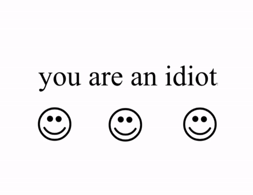

# You Are an Idiot

  

  <strong>Экспериментальный Python-проект, вдохновлённый классическим интернет-пранком «You Are an Idiot».</strong>

  <a href="https://github.com/AnaliniDebozhir228/You-are-idiot/releases">Релизы</a>
  ·
  <a href="https://github.com/AnaliniDebozhir228/You-are-idiot/blob/master/idiot.py">Исходный код</a>

---

## ⚠️ Важное предупреждение

**Это демонстрационный пранк с потенциально disruptive-поведением, а не обычное настольное приложение. Не запускайте его на основном компьютере.**

Текущая реализация может:
- создавать большое количество окон;
- перемещать окна по экрану и трясти главное окно;
- воспроизводить звук в цикле.

Это может мешать работе и привести к зависанию приложения или системы. Не запускайте неизвестные сборки и не используйте проект на устройствах других людей.

## О проекте

Проект написан на Python и показывает, как с помощью графического интерфейса можно воспроизвести визуальные эффекты, анимацию и звук, характерные для старого интернет-пранка.

Репозиторий предназначен для ознакомления с исходным кодом и изучения устройства проекта. Он не позиционируется как безопасная программа для повседневного использования.

## Содержимое репозитория

| Файл | Назначение |
| --- | --- |
| `idiot.py` | Основной исходный файл проекта |
| `you-are-an-idiot.gif` | GIF-анимация |
| `you-are-an-idiot.png` | Изображение для интерфейса |
| `you-are-an-idiot.mp3` | Звуковой файл проекта |

## Релизы

Архивы и заметки к версиям находятся на странице **[GitHub Releases](https://github.com/AnaliniDebozhir228/You-are-idiot/releases)**.

В релизах могут присутствовать сборки с более выраженными эффектами. Относитесь к ним с особой осторожностью: описание релиза не является гарантией безопасности файла.

## Безопасность

- Не отключайте антивирус ради запуска проекта.
- Не запускайте сборки с правами администратора.
- Не используйте программу на рабочем или чужом компьютере.
- Если вы изучаете проект, ограничьтесь чтением исходного кода.

## Отказ от ответственности

Проект опубликован в ознакомительных целях. Автор README не гарантирует отсутствие ошибок, сбоев или нежелательных последствий при запуске сторонних сборок. Использование любых файлов проекта остаётся на ответственности пользователя.
